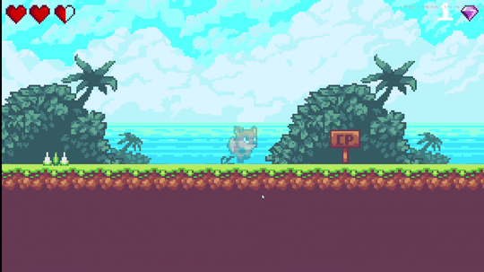

# Fox's Tale

A level-based 2D platformer built with Unity and C#: run, jump, stomp enemies, collect gems, respawn at checkpoints, and fight a boss — wrapped in a complete menu / level-select / save flow.

[中文说明](README.md)



## Overview

- **Genre**: 2D side-scrolling platformer
- **Engine**: Unity 2022.3.62f3c1 (LTS), URP 2D
- **Content**: 3 levels (2 standard + 1 boss), a level-select map, best-time and gem records
- **Code**: 34 C# scripts

## Controls

| Action | Key |
|---|---|
| Move | `A` / `D` or `←` / `→` |
| Jump (double jump in mid-air) | `Space` |
| Pause | `Esc` |

## Features

- **Player**: run, jump, double jump, knockback, invincibility frames, enemy stomp bounce
- **Level mechanics**: moving platforms, bounce pads, switches/doors, crushers, kill zones, checkpoints
- **Enemies**: ground patrol (timed patrol with endpoint turnaround), flying enemy (patrol + chase)
- **Boss**: a finite state machine with shooting / hurt / moving / ended states, phase-based speed-up, bullets and mines
- **Systems**: health HUD, gem counter, screen fades, pause, level select, `PlayerPrefs` save data

## Technical Highlights

- **`Level Pack.prefab`** — the player, UI, managers, and shared level objects live in a single "level pack" prefab. Level scenes instantiate it and override only what differs, so shared systems are maintained in one place instead of being re-placed in every scene.
- **`PlatformRider`** — moving platforms deliberately avoid `SetParent` (which stretches the player when the platform is scaled and fights `Rigidbody2D` velocity). Instead, the rider applies the platform's per-frame position delta to the player's rigidbody and uses the contact normal to decide whether the player is standing on it.
- **`GameState`** — pause / input-lock state lives in a plain static C# class. `PlayerController` only reads `CanControlPlayer`, so it no longer depends on a `PauseMenu` singleton that may not exist in the scene.
- **Boss FSM** — `enum + switch` with four states. On each hit, the shot/mine interval is recomputed as `base / speedUp^hitCount` with a lower clamp, avoiding the runaway bullet-spam caused by repeated in-place division.
- **Mine registry** — `BossTankMine` registers itself in `OnEnable` / `OnDisable`; the boss clears the field via `ExplodeAll()` instead of calling `FindObjectsOfType` on every hit.

## Running the Project

**In the editor**

1. Open this folder with Unity **2022.3.62f3c1**;
2. Open `Assets/Scenes/Main_Menu.unity`;
3. Press Play.

**Build**

`File → Build Settings` already lists the six scenes: `Main_Menu`, `Level_Select`, `Level_1`, `Level_2`, `Boss_Level`, `Victory_Scene`.

## Project Structure

```
Assets/
├── Animations/          # Player / enemy / boss animator controllers
├── Prefabs/             # Player, enemies, mechanics, UI, Level Pack
├── Scenes/              # Six build scenes
├── script/              # All C# scripts
├── 2D Platformer Assets/# Art and audio
└── Settings/            # URP configuration
```

## Known Issues

- Save data uses `PlayerPrefs` (plain text, no versioning or migration);
- Player movement writes `Rigidbody2D.velocity` in `Update` rather than `FixedUpdate`;
- Bullets, mines, and effects still use `Instantiate` / `Destroy` with no object pooling;
- Level data (waypoints, map nodes) is hand-placed, which does not scale well;
- No audio/resolution settings screen and no gamepad support.

## Roadmap

1. Input abstraction layer plus coyote time, jump buffering, and variable jump height;
2. JSON save data (with version field and migration) to replace `PlayerPrefs`;
3. Object pooling for high-frequency `Instantiate` calls;
4. EditMode tests for damage, save data, and boss state transitions;
5. Data-driven configuration via `ScriptableObject` for enemies and levels.

## Environment

- Unity 2022.3.62f3c1 (China edition)
- URP 14.0.12, 2D Renderer
- Target platforms: Windows / WebGL

## Credits

- **Base framework**: built by following the Bilibili tutorial
  *Learn to Code by Making a 2D Game in Unity and C# (Part 1)*
  (https://www.bilibili.com/video/BV1nT411p7qw/), originally the GameDev.tv course
  *Learn to Code by Making a 2D Platformer in Unity*.
- **Art**: [Ansimuz – Sunny Land](https://ansimuz.itch.io/sunny-land-pixel-game-art),
  licensed under **CC0 1.0** (free for commercial use, modification and redistribution).
- **Music / SFX**: replaced with **CC0 1.0** assets from
  [Kenney](https://kenney.nl/assets) (Digital Audio / Impact Sounds / Music Jingles /
  UI Audio). Per-file sources are listed in
  [THIRD_PARTY_NOTICES.md](THIRD_PARTY_NOTICES.md). The course audio and font have
  been removed.
- **Font**: [Press Start 2P](https://fonts.google.com/specimen/Press+Start+2P)
  (SIL OFL 1.1).
- **Engine assets**: TextMesh Pro and the URP template are under the Unity
  Companion License.

See [THIRD_PARTY_NOTICES.md](THIRD_PARTY_NOTICES.md) for the full list of
third-party assets and their licenses.

On top of that framework I:

- refactored the player state update and the moving-platform rider;
- extracted `GameState` to centralize pause/input locking and fix cross-scene state leaks;
- rewrote the boss hit speed-up and mine management;
- adjusted the health HUD and level parameters, and fixed the victory-screen copy.
