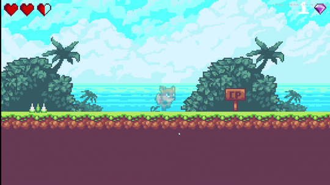

# Fox's Tale

一个关卡制的 2D 平台跳跃小游戏：跑跳、收集、踩敌、检查点重生、三个关卡和一个 Boss 战，完整的菜单 / 关卡选择 / 存档流程。

[English](README.en.md)



## 简介

- **类型**：2D 横版平台跳跃
- **引擎**：Unity 2022.3.62f3c1（LTS），URP 2D
- **内容**：3 个关卡（2 个普通关 + 1 个 Boss 关）、关卡选择地图、最佳时间 / 宝石记录
- **代码量**：约 34 个脚本、1,800 行 C#

## 操作

| 操作 | 按键 |
|---|---|
| 移动 | `A` / `D` 或 `←` / `→` |
| 跳跃（空中可二段跳） | `Space` |
| 暂停 | `Esc` |

## 内容

- **角色**：跑动、跳跃、二段跳、受击击退、无敌帧、踩敌反弹
- **关卡机关**：移动平台、弹跳板、开关门、压路机、秒杀区、检查点
- **敌人**：地面巡逻（时间片巡逻 + 端点折返）、飞行敌人（巡逻 + 追击）
- **Boss**：射击 / 受击 / 移动 / 结束的有限状态机，血量阶段提速、地雷与子弹
- **系统**：血量 HUD、宝石计数、淡入淡出、暂停、关卡选择、`PlayerPrefs` 存档

## 技术要点

- **`Level Pack.prefab`**：把玩家、UI、各管理器和关卡公共物体收在一个“关卡包”里，关卡场景实例化后按需覆盖参数，避免每个场景重复摆放。
- **`PlatformRider`**：移动平台没有用 `SetParent`（会因平台缩放拉伸玩家、和刚体速度打架），而是每帧把平台的位移差加到玩家刚体位置，用接触法线判断“是否站在上面”。
- **`GameState`**：暂停 / 输入锁定的全局状态用纯 C# 静态类表达，`PlayerController` 只读一个 `CanControlPlayer`，不再跨场景依赖 `PauseMenu` 单例。
- **Boss 状态机**：`enum + switch` 实现射击 / 受击 / 移动 / 结束四态，受击时按 `base / speedUp^hitCount` 提速并钳制下限，避免连乘导致弹幕化。
- **地雷注册表**：`BossTankMine` 在 `OnEnable/OnDisable` 自注册，Boss 清场时调用 `ExplodeAll()`，替代每帧 `FindObjectsOfType`。

## 运行方式

**在编辑器中**

1. 用 Unity **2022.3.62f3c1** 打开本目录；
2. 打开 `Assets/Scenes/Main_Menu.unity`；
3. 点 Play。

**构建**

`File → Build Settings`，已包含 6 个场景：`Main_Menu`、`Level_Select`、`Level_1`、`Level_2`、`Boss_Level`、`Victory_Scene`。

## 项目结构

```
Assets/
├── Animations/          # 角色 / 敌人 / Boss 动画控制器
├── Prefabs/             # 玩家、敌人、机关、UI、Level Pack
├── Scenes/              # 6 个构建场景
├── script/              # 全部 C# 脚本
├── 2D Platformer Assets/# 美术与音频素材
└── Settings/            # URP 配置
```

## 已知问题

- 存档使用 `PlayerPrefs`，明文、无版本迁移，不适合正式项目；
- 角色移动在 `Update` 中直接写 `Rigidbody2D.velocity`，没有用 `FixedUpdate`；
- 子弹、地雷、特效仍用 `Instantiate/Destroy`，未做对象池；
- 关卡数据（路点、地图节点）全部手摆，扩展成本高；
- 没有音频 / 分辨率设置界面，没有手柄支持。

## 后续计划

1. 输入层抽象 + 土狼时间 / 跳跃缓冲 / 可变跳跃高度；
2. JSON 存档（版本号 + 迁移）替换 `PlayerPrefs`；
3. 对象池替换高频 `Instantiate`；
4. 为伤害、存档、Boss 状态机补 EditMode 测试；
5. 数据驱动：`ScriptableObject` 管理敌人与关卡配置。

## 开发环境

- Unity 2022.3.62f3c1（中国版）
- URP 14.0.12，2D Renderer
- 目标平台：Windows / WebGL

## 致谢

- **代码框架**：最初跟随 Bilibili 教程《在 Unity 和 C# 中制作 2D 游戏来学习编码（上）》
（https://www.bilibili.com/video/BV1nT411p7qw/），以及
  《通过在Unity和C＃中制作2D游戏来学习编码-下》 （https://www.bilibili.com/video/BV1UP411U7PP/）
  原课程为 GameDev.tv 的
  *Learn to Code by Making a 2D Platformer in Unity*）搭建。
- **美术素材**：[Ansimuz – Sunny Land](https://ansimuz.itch.io/sunny-land-pixel-game-art)，
  采用 **CC0 1.0** 许可，可商用、修改与再分发。
- **音乐 / 音效**：全部替换为 [Kenney](https://kenney.nl/assets) 的 **CC0 1.0** 素材
  （Digital Audio / Impact Sounds / Music Jingles / UI Audio），逐文件来源见
  [THIRD_PARTY_NOTICES.md](THIRD_PARTY_NOTICES.md)。原课程提供的音频与字体**已移除**。
- **字体**：[Press Start 2P](https://fonts.google.com/specimen/Press+Start+2P)（SIL OFL 1.1）。
- **引擎资源**：TextMesh Pro、URP 模板为 Unity Companion License。

第三方素材的完整清单与许可文本见 [THIRD_PARTY_NOTICES.md](THIRD_PARTY_NOTICES.md)。

在教程框架之上，我做了这些改动：

- 重构角色控制的状态更新与移动平台带人逻辑；
- 抽出 `GameState` 统一暂停与输入锁，修复跨场景状态泄漏；
- 重写 Boss 的受击提速与地雷管理；
- 调整血量 UI 与关卡参数，修正胜利界面文案。


